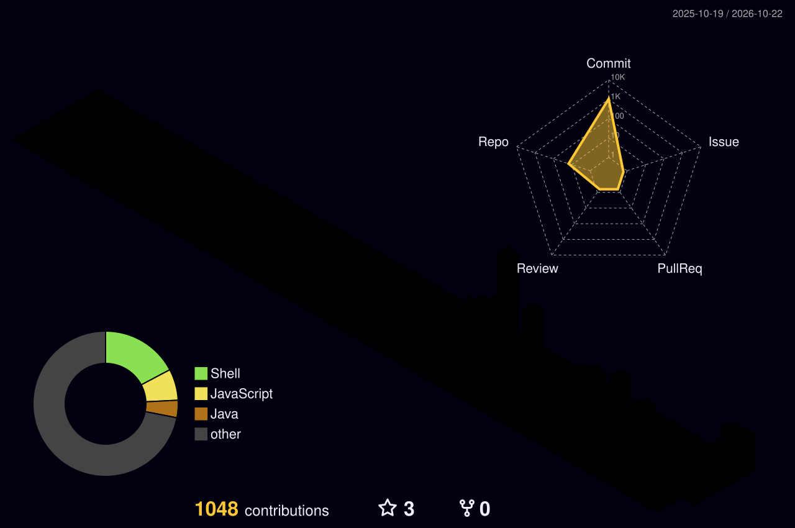

# 👋 안녕하세요, 남기석입니다

### 🌐 Network Engineer를 준비하고 있습니다

 

**GNS3 / Cisco IOS** 기반 네트워크 실습을 중심으로 공부하고 있습니다.

*"이론만이 아니라, **직접 구축하고 부숴 보며** 배웁니다."*

---

## 👤 About Me

- 💼 PC/OA 지원 업무 → 네트워크 엔지니어로 전환 준비 중
- 🛠 GNS3 · Cisco IOS 로 라우팅 / 스위칭 / 보안 랩 구성
- 📚 이론은 **GitBook** 에 *책(Guide)* 과 *위키(Wiki)* 두 형식으로 정리하고, 실습은 **[GitHub](https://github.com/KSNAM97?tab=repositories)** 로 관리
- 🎯 목표 : Network Engineer

---

## 🛠 Tech Stack

**🌐 Networking**  

**🧪 Simulation & Labs**  

---

## 📚 Portfolio Index

> 📖 **Guide (책)** : 처음부터 순서대로 읽도록 엮은 학습서  
> 🔎 **Wiki (위키)** : 개념·명령어를 주제별로 찾아보는 레퍼런스

| 카테고리 | 내용 | 📖 Guide | 🔎 Wiki |
|---|---|---|---|
| 📗 Network | OSI, 라우팅 / 스위칭, ACL, VPN | [Network Guide](https://ksnam97.gitbook.io/network_guide/) | [Network Wiki](https://ksnam97.gitbook.io/network_wiki/) |
| 💻 Hands-on Labs | GNS3 / Cisco 실습 결과물 | [GitHub](https://github.com/KSNAM97?tab=repositories) | - |

---

## 🏢 Featured Projects

| 프로젝트 | 내용 |
|---|---|
| [Cisco DMVPN + IPsec](https://github.com/KSNAM97/cisco-dmvpn-ipsec-network) | DMVPN Phase 2/3 + IPsec, OSPF-EIGRP 재분배, HSRP 이중화, NAT 기반 본사-지사 WAN |
| [Multi-vendor WAN DMVPN + MPLS Lab](https://github.com/KSNAM97/multivendor-wan-dmvpn-mpls-lab) | Cisco + Arista, DMVPN, ISP 이중화(dual-homing) |
| [Multi-vendor EVPN + MPLS + IPsec Lab](https://github.com/KSNAM97/multivendor-evpn-mpls-ipsec-lab) | 멀티벤더 EVPN / MPLS / IPsec 실습 |
| [Campus Network](https://github.com/KSNAM97/Campus-VLAN-OSPF-NTP-Security) | L2 + L3 + OSPF + NTP + Security 종합 (EtherChannel / VTP / STP / SVI / Inter-VLAN / DoS) |
| [IPsec Network Security Lab](https://github.com/KSNAM97/IPsec-Network-Security-Lab) | IPsec VPN, NAT, CBAC, Reflexive ACL + 통신 보안 이론 정리 |
| [OSPF + ACL Multi-ISP](https://github.com/KSNAM97/OSPF-ACL-Multi-ISP-Network) | OSPF Multi-ISP 백본 + ACL 실습 |
| [EIGRP Multi-ISP](https://github.com/KSNAM97/EIGRP-Multi-ISP-Network) | EIGRP AS 100 Multi-ISP 백본 + Route Summarization |

---

### 📊 GitHub Stats

<!-- 3D_CONTRIB_START -->

<!-- 3D_CONTRIB_END -->

### 📫 Visitors

